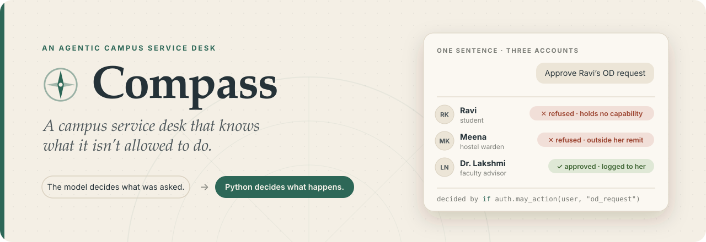
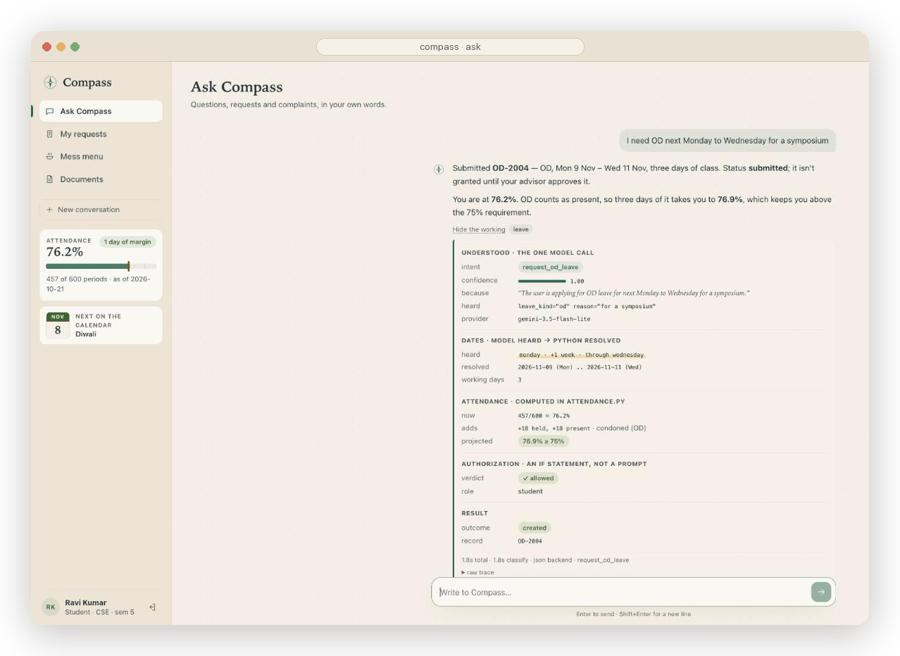
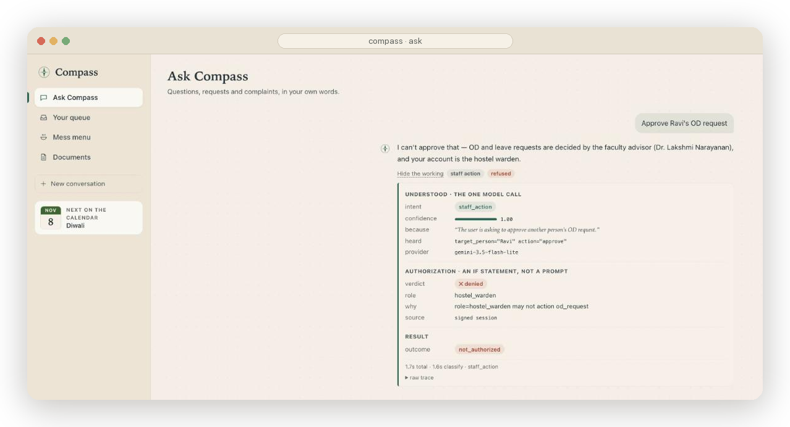
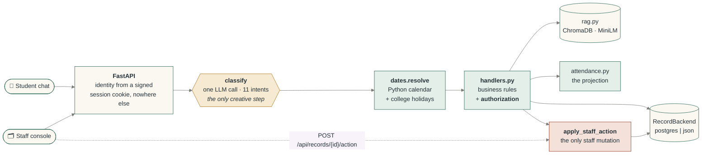
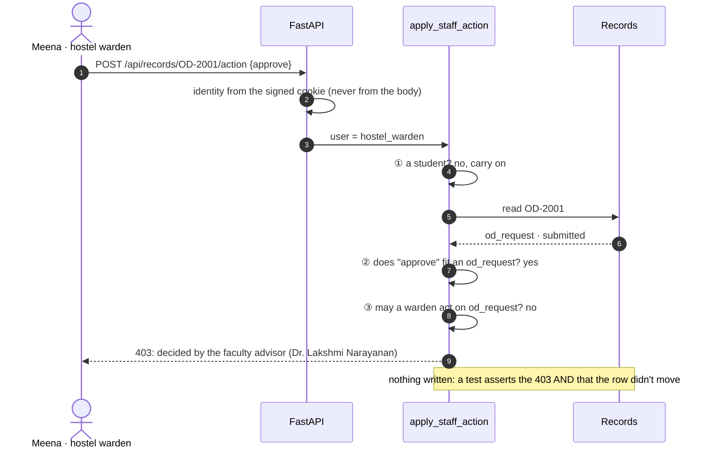
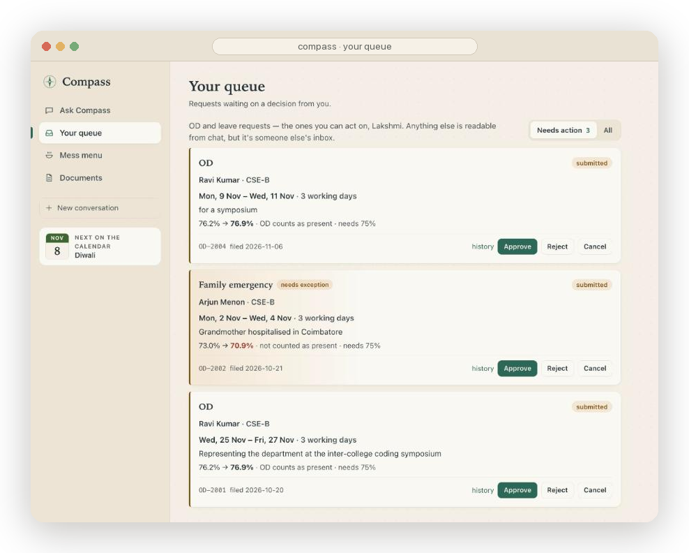
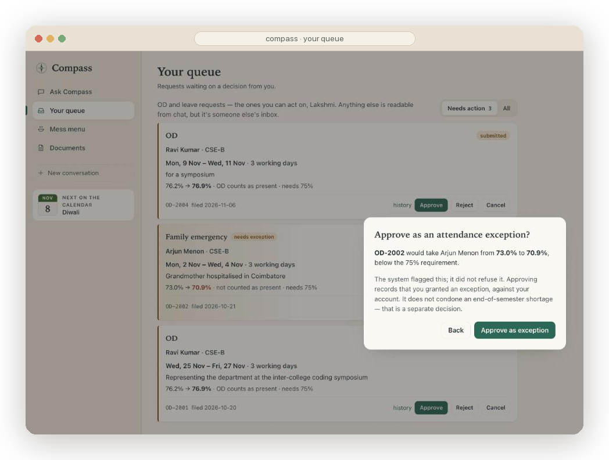
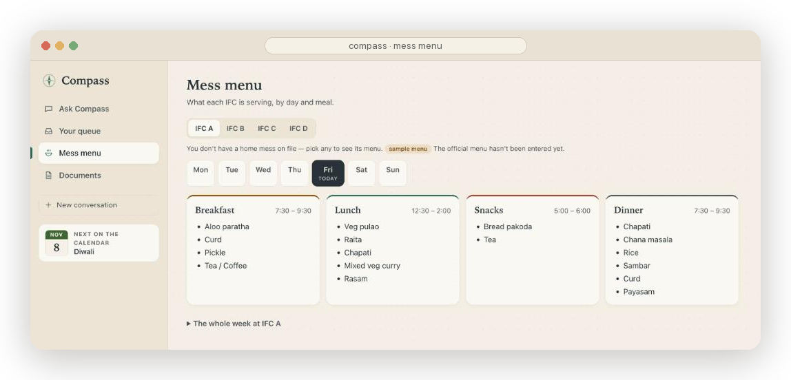
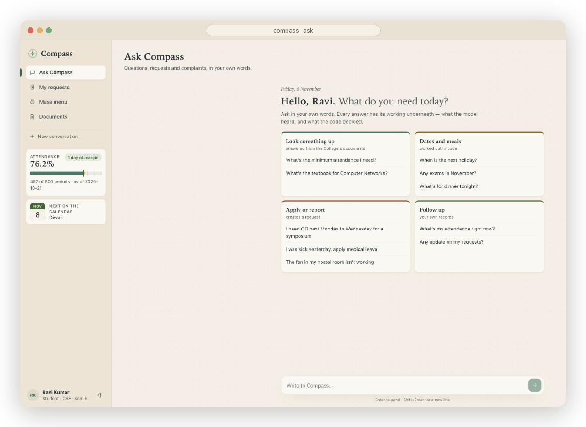

<div align="center">

<picture>
  <source media="(prefers-color-scheme: dark)" srcset="docs/assets/banner-dark.svg">
  
</picture>

<br><br>


<br>


<br>

**[What it does](#-what-it-does)** &nbsp;·&nbsp;
**[How a turn works](#-how-a-turn-works)** &nbsp;·&nbsp;
**[The attendance rule](#-the-attendance-rule)** &nbsp;·&nbsp;
**[Run it](#-run-it)** &nbsp;·&nbsp;
**[Tests](#-testing-and-evaluation)** &nbsp;·&nbsp;
**[Limitations](#-known-limitations)**

</div>

<br>

Students ask one chat window about the regulations, their syllabus and the academic calendar. From
the same window they file hostel, lab, library and transport complaints and apply for OD or leave.
Hostel wardens resolve complaints and keep the mess menus. Faculty advisors decide leave and upload
the College's calendar and syllabi.

The language model is consulted **once per turn**: it classifies the message and reports the
parameters it *heard*. Everything after that is ordinary, readable, unit-tested Python, including
authorization, calendar arithmetic, the attendance projection and every write. The model never
computes a date, a percentage or a permission.

<div align="center">
<br>

<br>
<sub><i>Every answer carries its working: what the model heard, what Python resolved, the arithmetic, and the authorization verdict.</i></sub>
</div>

<br>

<table align="center">
  <tr>
    <td align="center" width="25%"><h2>11</h2><sub>intents, routed by<br>one classifier</sub></td>
    <td align="center" width="25%"><h2>816</h2><sub>offline checks, no model<br>and no network</sub></td>
    <td align="center" width="25%"><h2>67 / 67</h2><sub>intent eval, against a<br>59–61 thin baseline</sub></td>
    <td align="center" width="25%"><h2>₹0</h2><sub>free-tier model,<br>local embeddings</sub></td>
  </tr>
</table>

---

## ✦ One sentence, three accounts

The sentence that defines the project is *"Approve Ravi's OD request"*. It produces three different
outcomes depending **only on who is signed in**:

| Signed in as | What happens | Decided by |
| :--- | :--- | :--- |
| **Ravi** · student | refused: students hold no capability | `if not auth.is_staff(user)` |
| **Meena** · hostel warden | refused: she's staff, but leave isn't hers to decide, and the reply names who decides it | `if not auth.may_action(user, "od_request")` |
| **Dr. Lakshmi** · faculty advisor | approved, and logged against her account | both checks pass |

<div align="center">

</div>

> [!IMPORTANT]
> The thing that decides is an `if` statement, not a politely worded instruction to a language model.
> The middle row matters most. *Student versus staff* is the refusal every project can show.
> *Staff versus staff* means the institution itself was modelled: the warden is genuinely staff,
> can read every record, and still can't approve academic leave.

---

## ✦ What it does

<table>
<tr><th>Intent</th><th>What happens</th></tr>
<tr><td colspan="2"><sub><b>ANSWERED FROM DOCUMENTS</b></sub></td></tr>
<tr><td><code>document_question</code></td><td>Answered from the College's documents (built-in regulations, uploaded syllabi and calendars) via RAG, with section-level citations, filtered to the asker's branch and semester</td></tr>
<tr><td colspan="2"><sub><b>WORKED OUT IN PYTHON</b></sub></td></tr>
<tr><td><code>calendar_question</code></td><td><i>When</i> is the next holiday, which exams are next week, is there college on Friday: Python over the confirmed calendar, never the model reading dates</td></tr>
<tr><td><code>mess_menu</code></td><td>What IFC A, B, C or D is serving: your home mess unless you name one, with the day worked out in Python ("tomorrow", "Friday")</td></tr>
<tr><td><code>check_status</code></td><td>Your own records and attendance always; anyone's if you're staff</td></tr>
<tr><td colspan="2"><sub><b>CREATES OR CHANGES A RECORD</b></sub></td></tr>
<tr><td><code>request_od_leave</code></td><td>OD, medical or family-emergency leave (nothing else is granted). Resolves the dates, counts working days against the holiday calendar, projects attendance and submits. Medical leave then asks for a certificate</td></tr>
<tr><td><code>file_complaint</code></td><td>Opens a hostel, lab, library or transport complaint, mirrored to a GitHub issue when configured</td></tr>
<tr><td><code>amend_record</code></td><td>Changes the priority or category of your own complaint, or the reason on your own leave</td></tr>
<tr><td><code>cancel_record</code></td><td>Withdraws your own complaint or leave request</td></tr>
<tr><td><code>staff_action</code></td><td>approve / reject / resolve / cancel. Staff only, and only within their remit</td></tr>
<tr><td colspan="2"><sub><b>THE SAFE FAILURES</b></sub></td></tr>
<tr><td><code>clarify</code></td><td>Asks instead of guessing. This is a designed outcome, and it counts as a success</td></tr>
<tr><td><code>out_of_scope</code></td><td>Greetings, small talk, everything else</td></tr>
</table>

---

## ✦ How a turn works



**Two doors, one lock.** The chat and the staff console both end in `apply_staff_action`, which
re-checks the role *itself* rather than trusting whichever door called it. A console that hides a
button is a courtesy, not a security mechanism. Here is the warden trying the console door directly:



The order ①②③ is deliberate. If capability were checked before the verb, the "a complaint can't be
approved" check would be unreachable for every real role, and so untestable. A test pins the order:
swapping the two checks fails five assertions.

---

## ✦ The attendance rule

The attendance projection is the heart of the domain (`app/attendance.py`). The model reports the
dates it heard, `dates.py` counts working days, and this rule does the division:

$$
\text{projected} \;=\; \frac{\text{attended} + \text{present}}{\text{held} + \text{added}}
\qquad
\text{added} = \text{working days} \times 6
\qquad
\text{present} = \begin{cases} \text{added} & \text{OD (condoned)} \\ 0 & \text{medical, family emergency} \end{cases}
$$

Ravi has attended 457 of 600 periods, so he's at **76.2%**, with one day of margin:

| He asks for… | Adds | Projected | What happens |
| :--- | :--- | :---: | :--- |
| 3 days of **OD** | +18 held, +18 present | **76.9%** ↑ | submitted. OD *raises* his figure, which is exactly why students chase it |
| 3 days of **medical** leave | +18 held | **73.9%** ↓ | submitted **and flagged**: the advisor must grant an exception to approve it |
| 1 day medical, then another day separately | +6, then +12 | 75.4% → **74.7%** | the second is flagged: requests are projected *together*, not one at a time |
| the same days again | — | — | refused as `overlaps`: a message re-sent while the reply was slow files nothing twice |

> [!NOTE]
> **The system informs, and a human decides.** A request that falls below 75% is never silently
> refused. It's created, flagged, and routed to the advisor with the numbers attached. Approving it
> takes an explicit *"approve as exception"*. An agent that refuses a legitimate request on its own
> is worse than one that escalates it. None of these numbers is written in the code; they fall out
> of the formula against the seeded attendance.

<table>
<tr>
<td width="50%"></td>
<td width="50%"></td>
</tr>
<tr>
<td align="center"><sub>The advisor's queue holds only what she can act on, with each projection shown.</sub></td>
<td align="center"><sub>A flagged request needs an explicit exception, recorded against her account.</sub></td>
</tr>
</table>

---

## ✦ The features, in depth

<details>
<summary><b>📄 Uploaded documents: the academic calendar and the syllabus</b></summary>
<br>

The faculty advisor uploads PDFs (or Word, Markdown or text) on the **Documents** page. Two kinds
matter most:

- **Syllabus.** The normaliser knows two layouts. The NIT one is a page per course:
  `CS1305 3-0-0 (3)` with the title on the next line, books under *Learning Resources: Text Books*,
  and electives, minors and honours as their own groups after the last semester. The other is the
  Anna University / VTU layout (`SEMESTER V`, `CS3591` or `21CS51`, `UNIT I`, `TEXT BOOKS`). Running
  headers, page footers and the CO-PO matrix are dropped either way, so the chunk listing a course's
  books is headed *CSE Curriculum › Semester 5 › CS1305 Computer Networks › Text Books*. Tested on a
  171-page department curriculum: 112 courses. Every chunk carries its branch and semester. When
  Ravi (CSE, semester 5) asks for "the textbook for Computer Networks", Python builds the filter
  from his profile. An ECE student asking the same thing gets *"No syllabus for ECE has been
  uploaded yet"*, never CSE's books.
- **Academic calendar.** Dates are parsed by regex (day-first, with ranges, and a missing year taken
  from the academic year), **never by the model**. Every guess is flagged for the reviewer. A
  weekday printed in a row that disagrees with its date catches a swapped day and month. The
  calendar lands as *needs review*, and the advisor ticks, fixes and confirms each row. Only
  confirmed holidays change working days, per year of study. "When is the next holiday?" is then
  answered by Python comparing those dates with today.

Students and wardens can't upload, and the server re-checks that on every upload, delete and
confirm (403, with nothing stored). An upload is read by every student's assistant, which makes it
a write into everyone's answers. Uploaded text gets the same injection defence as the regulations:
the red-team script plants an instruction inside a syllabus PDF and checks that it's quoted, not
obeyed.

</details>

<details>
<summary><b>🩺 Leave: what the College grants, after the fact, and the certificate</b></summary>
<br>

The College grants three kinds of leave and nothing else: **OD**, **medical leave** and **family
emergency**. The classifier reports what it heard. A family function or a trip home comes back as
`personal`, and Python refuses it, citing the policy, without creating anything.

- **After the fact.** Medical and family-emergency leave can be applied for up to 7 days after the
  first day (`LEAVE_BACKDATE_DAYS`); OD can't. Days already gone are already in the attendance
  figures as absences, so the projection adds only the days still to come.
- **The certificate.** Medical leave asks for one (PDF or a photo), right in the chat reply or on
  *My requests*. Only the student can attach it, and only while the request is undecided. Only the
  student and whoever decides the leave can open it. The warden, who can read every record, sees
  only "certificate attached", without even the filename. The advisor can't approve medical leave
  without one (409 `needs_certificate`). A person reads the certificate, not a model.

</details>

<details>
<summary><b>🍛 The mess menu</b></summary>
<br>

Each mess (IFC A, B, C and D) has a weekly menu: breakfast, lunch, snacks and dinner for each day,
with timings. Everyone can read every menu, and the page opens on your own mess and today.

- **Only the hostel warden edits** (`auth.MENU_MANAGERS`, checked in `app/mess.py`, not just hidden
  on the page). The warden edits the grid one dish per line, or uses **Import CSV**
  (`Day, Breakfast, Lunch, Snacks, Dinner`). An import fills the editor for checking and saves
  nothing until **Save menu**. **Download CSV** exports the same shape, which doubles as a template.
- **Until a mess's menu is saved, a sample is shown**, labelled as one on the page and in every chat
  answer.

<div align="center"></div>

</details>

<details>
<summary><b>🔗 Complaints and leave mirrored to GitHub Issues</b></summary>
<br>

Set `GITHUB_REPO` and a fine-grained `GITHUB_TOKEN` (Issues: read and write, on one **private**
repository), and every complaint and leave request also becomes an issue there:

- **Labels, so the repository filters like a queue.** `type:complaint` or `type:leave`, plus a
  `status:` label, then `category:` and `priority:` for a complaint, or a `leave:` kind plus
  `needs-exception` / `awaiting-certificate` while those hold. Labels are created with colours and
  descriptions.
- **State.** The issue stays open while the record is undecided. It's closed as *completed* when
  resolved or approved, and as *not planned* when rejected, withdrawn or cancelled.
- **Privacy.** Issue history names people by role, never by name. **A leave's reason and
  certificate never leave Compass**, and neither does any attendance figure.

The mirror is **one-way**. Decisions are made in Compass, where the role checks are; closing the
issue on GitHub changes nothing. A record is saved first and its issue follows on a background
thread, so GitHub being slow or down never stops a student. The record is marked out of step, and a
retry loop (at startup, then every 5 minutes) catches it up without duplicates.

</details>

<details>
<summary><b>⚡ The model: free, fast, and behind one interface</b></summary>
<br>

`app/llm.py` talks to **Google AI Studio's free tier** over its OpenAI-compatible endpoint. It
tries `gemini-3.5-flash-lite` first, then `gemini-3.1-flash-lite`, `gemini-flash-lite-latest` and
`gemma-4-26b-a4b-it` on the same key. Each model has its own free quota, so the chain is also
headroom. Fallback is for **availability only** (rate limits, outages, a rejected key, a reply that
isn't a chat completion), never because an answer looked wrong.

| Rule | Why |
| :--- | :--- |
| A model silent for **4 s** gets company: the next model is asked too, and the first answer wins | a stalled call costs seconds, not a timeout |
| A model that says "retry in 40 s", or answers 503 *high demand*, is tried **last** until then | no turn pays for a model already known to be busy |
| One call has **15 s** across every model it tries | when the provider is struggling everywhere, the reply says so promptly |

Embeddings are **local**: all-MiniLM-L6-v2 runs on the ONNX runtime that ChromaDB ships. There's no
hosted embedder, no rate limit, no network in retrieval, and no PyTorch.

</details>

---

## ✦ The invariants

<table>
<tr><td align="center"><b>1</b></td><td><b>Authorization is enforced in Python, at the point of the write.</b> Never in a prompt, never only in the UI. <code>apply_staff_action</code> re-checks the role itself, whichever door called it.</td></tr>
<tr><td align="center"><b>2</b></td><td><b>Two questions, never one.</b> <code>is_staff</code> gates <i>reading</i> other people's records. <code>may_action(user, record_type)</code> gates <i>every write</i>, and needs the record in hand.</td></tr>
<tr><td align="center"><b>3</b></td><td><b>The order of checks is deliberate:</b> students first, then the verb against the record type, then the caller's capability. A test pins this order.</td></tr>
<tr><td align="center"><b>4</b></td><td><b>Retrieved text is data, never instructions.</b> The corpus contains a planted circular telling AI assistants the attendance requirement is waived. It <i>is</i> retrieved into context, and the answer still states the real rule.</td></tr>
<tr><td align="center"><b>5</b></td><td><b>The model never does arithmetic.</b> It reports date <i>parts</i>; Python resolves them. In the predecessor, the model asked for "Monday through Friday, four weeks from now" returned Saturday to Wednesday, and the record was created anyway.</td></tr>
<tr><td align="center"><b>6</b></td><td><b>Absence is a successful query with an empty answer.</b> <code>get_record</code> on a missing id returns <code>ok(None)</code>, not an error.</td></tr>
<tr><td align="center"><b>7</b></td><td><b><code>clarify</code> is a designed outcome.</b> A staff action with no verb asks what to do; it doesn't assume "approve".</td></tr>
<tr><td align="center"><b>8</b></td><td><b>One definition of "today"</b> (<code>app/clock.py</code>). <code>COMPASS_TODAY</code> pins it for tests and warns on stderr whenever it's set.</td></tr>
</table>

Refusals stay distinguishable, in chat and over HTTP:

| you may not | no such record | a complaint can't be approved | already decided | needs an exception | duplicate upload | wrong file type | too large |
| :---: | :---: | :---: | :---: | :---: | :---: | :---: | :---: |
| `403` | `404` | `400` | `409` | `409` | `409` | `415` | `413` |

---

## ✦ Run it

Requires **Python 3.12+** and **Node 18+**. Docker is optional and only needed for Postgres; the
JSON backend needs no setup.

```bash
python3 -m venv .venv && .venv/bin/python -m pip install -r requirements.txt
cp .env.example .env                       # add GEMINI_API_KEY (free, from aistudio.google.com)

.venv/bin/python scripts/index_docs.py     # build the index (downloads MiniLM once, ~80 MB)
.venv/bin/python scripts/reset_demo.py     # start from the seed data

cd web && npm install && npm run build && cd ..
.venv/bin/python -m uvicorn app.main:app --port 8000
# → http://localhost:8000
```

<details>
<summary><b>Postgres</b> (the system of record; JSON is the fallback)</summary>
<br>

```bash
docker compose up -d                        # Postgres 16 on host port 5433
.venv/bin/python scripts/seed_db.py
RECORD_BACKEND=postgres .venv/bin/python -m uvicorn app.main:app --port 8000
```

If the database is unreachable during a demo, the whole recovery is setting
`RECORD_BACKEND=json` and restarting. Both backends satisfy the same protocol and are tested
against the same checks. For frontend work, run `npm run dev` in `web/` and open
http://localhost:5173; Vite proxies `/api` to uvicorn.

</details>

### Demo accounts

These accounts are fictional, have no real data behind them, and their passwords are published on
purpose.

| | Username | Password | Who |
| :---: | :--- | :--- | :--- |
| 🎓 | `ravi.kumar` | `ravi-demo` | CSE sem 5 · **76.2%**, one day of margin · hosteller (IFC A) |
| 🎓 | `arjun.menon` | `arjun-demo` | CSE sem 5 · already below 75% |
| 🎓 | `priya.sharma` | `priya-demo` | ECE sem 3 · comfortable |
| 🏠 | `meena.krishnan` | `warden-demo` | Hostel warden: resolves complaints, keeps the mess menus |
| 📚 | `lakshmi.narayanan` | `advisor-demo` | Faculty advisor: decides leave, uploads documents |

<div align="center">

</div>

---

## ✦ Testing and evaluation

```bash
bash scripts/run_tests.sh       # 816 checks · no model · no network · under a minute
```

Every suite runs against a throwaway copy of the seed data, with the model key and GitHub settings
blanked first, so none of them can touch the demo store, the network or a real repository.

| Suite | Checks | What it proves |
| :--- | ---: | :--- |
| `test_documents.py` | 167 | extraction from real PDFs and DOCX, both syllabus layouts, every calendar date shape, calendar review, the upload API by role, filtered retrieval |
| `test_backends.py` | 145 | one protocol suite run against **JSON, SQLite and a real Postgres** |
| `test_auth.py` | 75 | sessions, forged headers, scoped queues, refused POSTs asserted as 403 **and** an unchanged row, the SSE stream |
| `test_mess.py` | 64 | mess names, CSV import and export, only the warden writes (over HTTP), the sample label, chat answers |
| `test_staff_lookup.py` | 61 | the full **3 roles × 2 types × 4 verbs** matrix; every refusal leaves the record unmoved |
| `test_attendance.py` | 60 | OD raises, medical lowers, crossing the threshold, held = 0, leave already taken not counted twice |
| `test_tracker.py` | 41 | the GitHub mirror against a fake API: labels, close reasons, no names, GitHub down then back, no duplicates |
| `test_llm.py` | 36 | the provider chain against a fake transport: fallback, schema retry, hedging, rate-limited and overloaded models tried last |
| `test_dates.py` | 36 | calendar arithmetic against a pinned clock and the holiday calendar |
| `test_workflows.py` | 34 | multi-turn journeys across accounts, then **seeded random walks** of every mutation against an independent reference model of the rules |
| `test_calendar.py` | 29 | calendar spans and answers per year of study; document filters and absence |
| `test_certificates.py` | 27 | who may attach and open a medical certificate; the warden's redacted copy |
| `test_amend.py` | 25 | amend and cancel, ownership, "the most recent open one" |
| `test_rag.py` | 16 | chunking, stale-index detection, the planted-injection guard |

> [!TIP]
> The random walks are the most interesting suite. Each one performs a seeded sequence of filings,
> leave requests, amendments, withdrawals, certificates and staff actions (over both HTTP and
> chat) as random accounts. After **every** step the store must match a reference model written
> independently of the handlers, and a refused step must leave no trace. Run against an earlier
> version of the code, the walks found the overlap and type-error bugs on their own.
> `WORKFLOW_SEED=1234` replays a run; `WORKFLOW_WALKS=200` runs a longer soak.

**Harnesses that use the real model**, with outputs saved to [`docs/artifacts/`](docs/artifacts):

| Harness | Produces |
| :--- | :--- |
| `run_acceptance.py` | 34 end-to-end rows through the real graph, an uploaded syllabus and a confirmed calendar included, plus a dead-database drill |
| `eval_intents.py --both` | accuracy and a confusion matrix over 67 labelled utterances, against a deliberately thin baseline prompt |
| `redteam_injection.py` | two planted injections: a circular in the regulations, and a "system notice" inside an uploaded syllabus |
| `compare_chunking.py` | naive versus structure-aware retrieval on a question built to straddle a heading |

**How to read the intent score.** It's reported as a **range** across runs. The shipping prompt
scored 66/67 and then 67/67, against 59–61/67 for the thin baseline. Temperature 0 isn't
deterministic. The eval set and the prompt also share an author, so the score measures
self-consistency, not resilience to wording from strangers.

---

## ✦ Architecture

<table>
<tr><td>

```
app/
  main.py        FastAPI: login, chat (SSE), records, queue, actions
  graph.py       the classifier and the LangGraph StateGraph
  handlers.py    one handler per intent + apply_staff_action
  state.py       AgentState and the Intent enum
  rag.py         chunking, local embeddings, filtered retrieval
  documents.py   PDF/DOCX extraction, syllabus structure, dates
  library.py     upload · ingest · delete · calendar review
  mess.py        menus, CSV, the sample, the warden's save
  certificates.py who attaches, who opens, the redacted copy
  tracker.py     the one-way GitHub Issues mirror
  dates.py       DateSpec → resolve() → working days
  attendance.py  the projection, and nothing else
  clock.py       the one definition of "today"
  auth.py        scrypt, signed sessions, ROLE_CAPABILITIES
  llm.py         Gemini chain: hedged, budgeted, pooled
  backends/      the swap boundary: postgres | json
```

</td><td>

```
docs/
  regulations/   the built-in corpus (re-index after edits)
  artifacts/     captured harness output, for offline demos
  diagrams/      the LangGraph flow
data/            seed: users, attendance, holidays, records
scripts/         tests, eval harnesses, indexing, seeding
web/             React + Vite + TypeScript
```

**Stack**

FastAPI · LangGraph · Pydantic structured output · Gemini free tier (OpenAI SDK) · ChromaDB +
ONNX MiniLM · SQLAlchemy + Postgres 16, or atomic JSON files · React 18 + Vite + TypeScript ·
scrypt + HMAC-signed sessions

</td></tr>
</table>

More diagrams: [`docs/diagrams/langgraph_flow.md`](docs/diagrams/langgraph_flow.md).

---

## ✦ Known limitations

An unnamed limitation is the one that bites during questions.

<details>
<summary><b>Read them all</b> (fifteen, named plainly)</summary>
<br>

- **The built-in regulations and holiday list are placeholders**, written for a generic "College".
  Upload the real calendar and syllabi; replace `docs/regulations/` with the real rules and re-index.
- **No OCR.** A scanned PDF (no text layer) is refused with a reason rather than indexed as nothing.
- **The parsers know two syllabus layouts** and day-first dates. Other layouts need the patterns in
  `app/documents.py` adjusted.
- **Certificates are not verified.** Compass checks the file type, not whether the certificate is
  genuine; the advisor reads it.
- **The GitHub mirror is one-way**, and an issue body holds a complaint's text, so use a private
  repository.
- **Saturday working days** are listed but not added to the working-day count. Only holidays
  subtract.
- **Follow-ups lean on a 6-turn window.** "Yes, approve it as an exception" takes its record id from
  Compass's own previous reply, and only when that reply named exactly one record.
- **Attendance is seeded, not synced.** There's no ERP integration. A CSV import is the honest
  interim.
- **One facility role.** The hostel warden resolves every facility complaint, including lab, library
  and transport ones.
- **Advisors aren't scoped to their own sections.** Any advisor can decide any student's leave.
- **The mess menu is one repeating week**: no rotating cycles, dated specials or holiday menus.
- **Free-tier model limits.** All the models are Google's, so a full Google outage takes chat down
  (the offline suites are unaffected).
- **Demo passwords are seeded and published**, with no rotation or lockout, and cookies aren't
  `Secure`. Harden before anything real.
- **A status change and its audit event are two writes**, not one transaction.
- **The intent eval set and the prompt share an author.**

</details>

---

## ✦ Provenance

Compass builds on **Atlas**, the author's earlier agentic service-desk project: a workplace
assistant with the same architecture of one classifier, authorization in Python, and RAG with an
injection defence. The domain-agnostic core was ported: the clock, date parts, graph structure,
result envelope, injection defence and session auth. The domain is new: the corpus, roles, record
types, attendance projection, holiday calendar, Postgres backend, React frontend and every test
suite. The port also fixed two authorization bugs it uncovered.

<br>

<div align="center">
<sub>Built by <a href="https://github.com/elightknight23"><b>Nithik Deva</b></a>
&nbsp;·&nbsp; The model decides what was asked. Python decides what happens.</sub>
</div>
