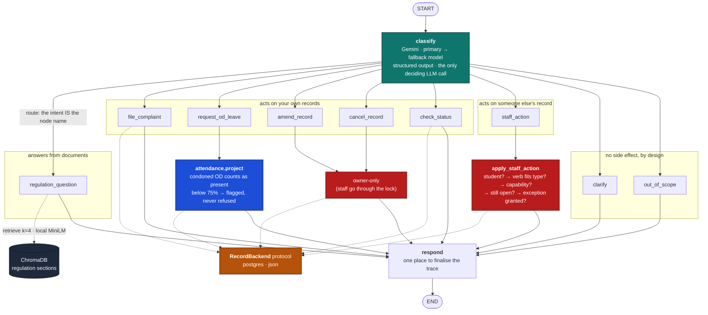
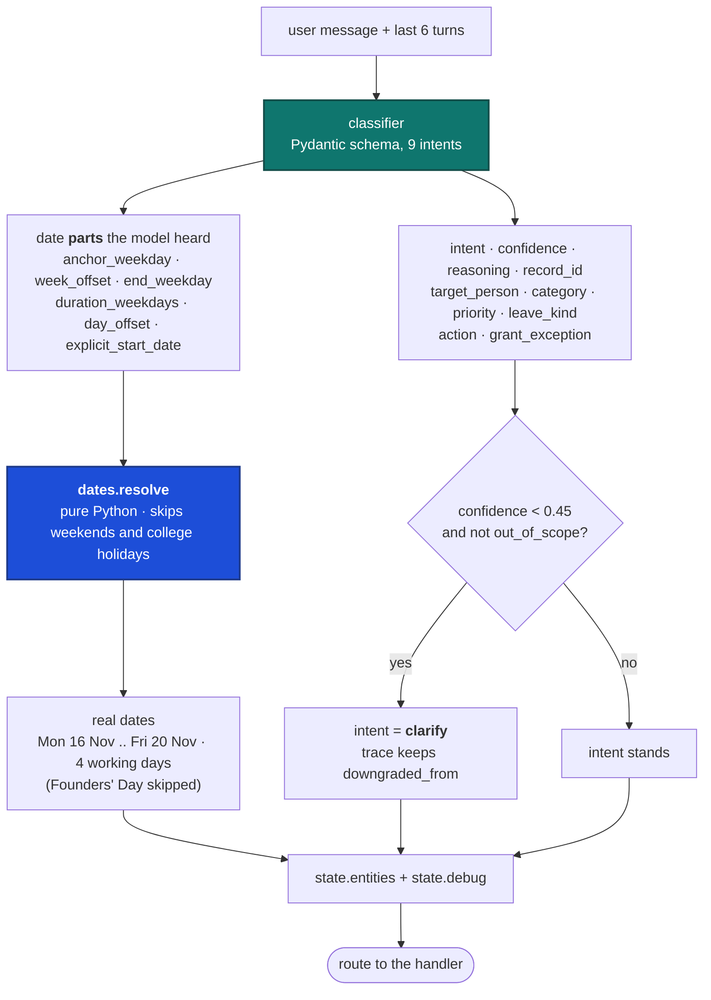

# The LangGraph flow

Both diagrams are read straight off `app/graph.py` and `app/handlers.py`.
Node names, edges and the confidence floor are the real ones, not a
simplification.

## 1. The graph

One classifier, nine handlers, one exit. The shape makes the argument:
**there is exactly one model call that decides anything, and it happens
before anything is allowed to touch a record.** Everything downstream of
`classify` is deterministic Python.

**Teal** is the only place a model decides anything. **Red** is where
authorization is decided. **Blue** is arithmetic the model never sees.
**Amber** is the seam that lets the record store change without any handler
knowing.

(`regulation_question`, `clarify` and `out_of_scope` also call the model, to
*phrase* an answer. None of those calls can choose an action or touch a
record.)

Two structural guarantees worth saying out loud:

- `assert set(HANDLERS) == {i.value for i in Intent}` at import time. A new
  intent without a node fails at startup, not mid-demo.
- Every handler edges into `respond`, never straight to `END`. One node stamps
  the trace, so no path can return a reply that isn't explained.

## 2. Inside `classify`: the seam

The model is asked what it *heard*, never what the date *is* and never what
the attendance *becomes*. It reports parts. `app/dates.py` does the calendar,
holidays included, and `app/attendance.py` does the division.

Both halves land in the trace (`heard` and `resolved`), and `/api/chat`
streams the classification *before* the answer. The UI shows the seam rather
than asserting it.

The floor's exception matters: `out_of_scope` is never downgraded. A confident
refusal and an unconfident refusal are both refusals, and routing a low-score
"write my assignment" into `clarify` would make the assistant ask a follow-up
question about something it should simply decline.

`target_person` is a lookup hint, never an authorization input. Turning
"Ravi" into a student and then acting on his record are two separate steps,
and only the second is gated, by `apply_staff_action`.
